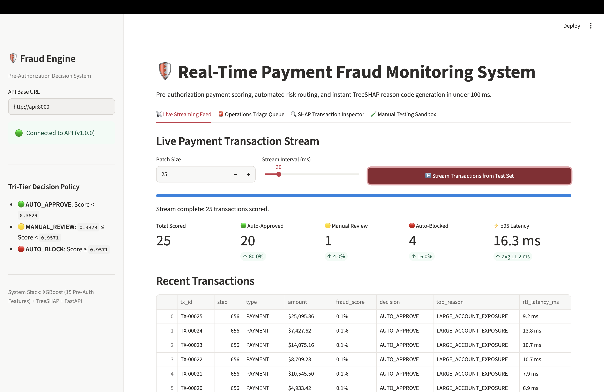
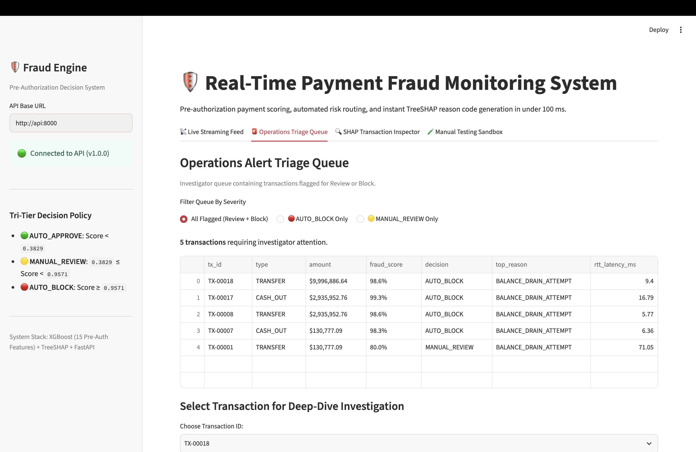
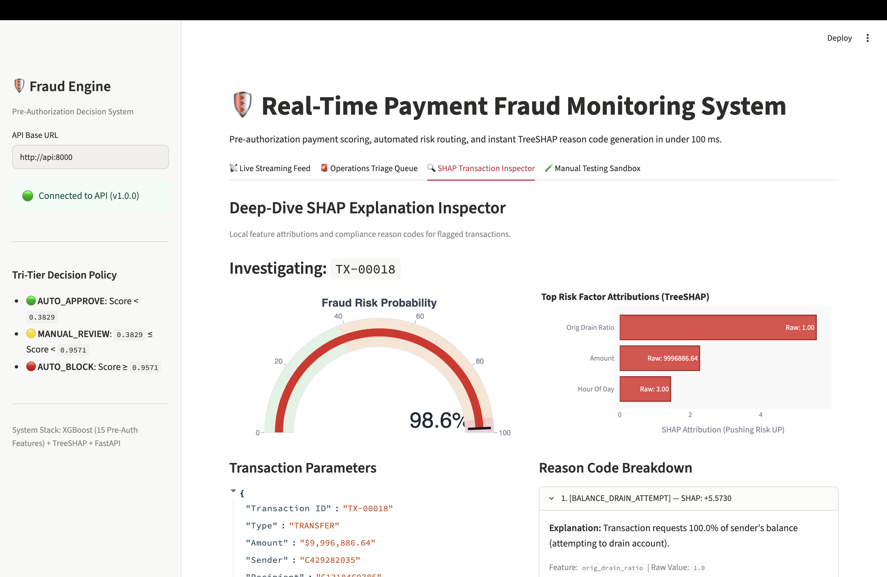
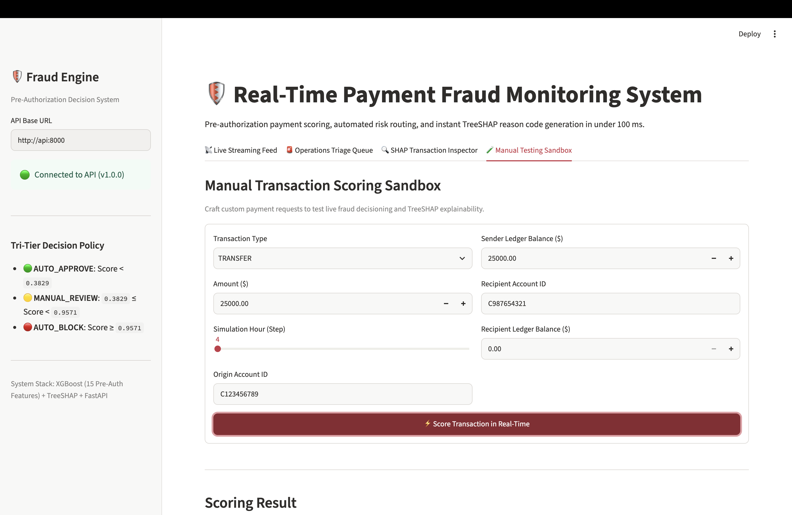
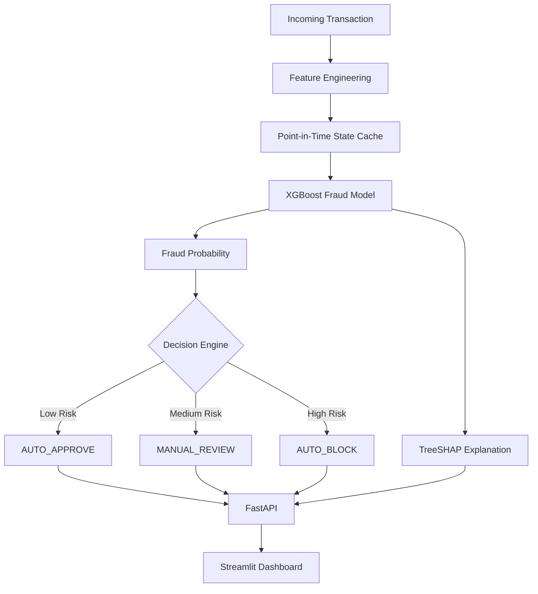

# 🛡️ Real-Time Payment Fraud Detection System

### An Explainable, Pre-Authorization Fraud Detection Engine

An end-to-end machine learning system for identifying suspicious mobile-money transactions **before authorization**. Powered by XGBoost, point-in-time feature engineering, TreeSHAP explainability, and a three-tier automated risk decision engine.

<p align="center">
  <a href="https://fraud-detection-dashboard-lodr.onrender.com">
    
  </a>
  <a href="https://fraud-detection-api-x946.onrender.com/docs">
    
  </a>
</p>

<p align="center">
  
  
  
  
  
  
  
</p>

---

## 🌐 Live Deployment

| Service | Description | Link |
|---|---|---|
| Streamlit Dashboard | Interactive fraud monitoring application | [Launch Dashboard](https://fraud-detection-dashboard-lodr.onrender.com) |
| FastAPI Backend | Transaction scoring API | [API Documentation](https://fraud-detection-api-x946.onrender.com/docs) |
| Health Endpoint | API and model health status | [Check Health](https://fraud-detection-api-x946.onrender.com/health) |
| GitHub Repository | Source code and documentation | [View Repository](https://github.com/Aparnaprabu/fraud-detection-system) |

*Deployment is hosted on Render's free tier. The first request after inactivity may take longer while the service starts.*

---

## 📸 Application Preview

### 1. Live Transaction Monitoring



Monitor scored transactions, fraud probabilities, automated decisions, and response latency through an interactive transaction stream.

### 2. Operations Triage Queue



Identify transactions requiring investigation, filter flagged transactions by severity, and select individual transactions for further analysis.

### 3. Explainable AI – TreeSHAP Inspector



Explore transaction-level fraud probabilities, feature attributions, and human-readable reason codes explaining suspicious activity.

### 4. Manual Transaction Testing Sandbox



Submit custom transaction details and observe real-time fraud scoring, automated decisions, and SHAP-based explanations.

---

## 🚀 Project Overview

Financial fraud detection systems must identify suspicious transactions quickly while avoiding unnecessary declines of legitimate payments.

This project implements a **pre-authorization fraud detection pipeline** that:

- Evaluates transactions using information available at decision time.
- Predicts fraud probability using an XGBoost classification model.
- Routes transactions through an automated three-tier decision engine.
- Explains individual predictions using TreeSHAP.
- Provides an interactive dashboard for monitoring and investigation.
- Exposes prediction and health-check endpoints through FastAPI.

**Dataset:** PaySim synthetic mobile-money transactions  
**Champion Model:** XGBoost  
**Model Features:** 15 pre-authorization features  
**Evaluation:** Chronological out-of-time test set

---

## ⭐ Key Features

| Capability | Implementation |
|---|---|
| Fraud Prediction | XGBoost probability-based classification |
| Risk Routing | Three-tier automated decision policy |
| Explainable AI | Transaction-level TreeSHAP explanations |
| Feature Engineering | Point-in-time historical account features |
| Leakage Prevention | Excludes seven post-settlement leakage features |
| Transaction Monitoring | Interactive Streamlit dashboard |
| Backend API | FastAPI prediction and health endpoints |
| State Management | Memory-mapped NumPy destination-account cache |
| Deployment | Docker, Docker Compose and Render |

---

## ⚖️ Three-Tier Fraud Decision Engine

The system converts fraud probabilities into operational decisions using validation-tuned thresholds.

| Fraud Probability | Decision | Action |
|---|---|---|
| Below 0.3829 | 🟢 AUTO_APPROVE | Automatically approve |
| 0.3829 to below 0.9571 | 🟡 MANUAL_REVIEW | Send for investigation |
| 0.9571 or above | 🔴 AUTO_BLOCK | Automatically block |

This policy separates low-risk transactions from uncertain and high-risk transactions.

---

## 🧠 Machine Learning Performance

### Champion Model: XGBoost

Evaluated on a chronological out-of-time test partition.

| Evaluation Metric | Test Performance |
|---|---:|
| PR-AUC | **0.9940** |
| ROC-AUC | **0.9999** |
| Precision | **99.64%** |
| Recall | **81.31%** |
| F1-Score | **89.55%** |
| Decision Threshold | **0.9571** |

### Model Comparison

| Model | PR-AUC | ROC-AUC | Precision | Recall | F1-Score |
|---|---:|---:|---:|---:|---:|
| Logistic Regression | 0.5855 | 0.9825 | 13.45% | 93.84% | 23.53% |
| LightGBM | 0.7160 | 0.8220 | 88.13% | 80.63% | 84.21% |
| **XGBoost** | **0.9940** | **0.9999** | **99.64%** | **81.31%** | **89.55%** |

### Test Set Confusion Matrix

| | Predicted Legitimate | Predicted Fraud |
|---|---:|---:|
| Actual Legitimate | 79,806 | 3 |
| Actual Fraud | 191 | 831 |

The model identifies most fraudulent transactions while producing very few false positives at the selected threshold.

*These results are based on the project's synthetic PaySim test partition and should not be interpreted as guaranteed real-world performance.*

---

## 🔬 Point-in-Time Feature Engineering

The serving pipeline uses **15 pre-authorization model features**.

Important feature categories include:

- Transaction amount and transaction type.
- Origin and destination account balances.
- Origin account drain ratio.
- Transaction time and hour of day.
- Merchant destination indicators.
- Historical recipient-account activity.

### Chronological Dataset Split

Instead of randomly splitting transactions, the project uses chronological boundaries to simulate evaluation on future transactions.

| Partition | Transaction Steps | Records |
|---|---|---:|
| Training | 1–550 | 6,166,019 |
| Validation | 551–650 | 115,770 |
| Testing | 651–743 | 80,831 |

### Data Leakage Prevention

Post-settlement information can make a fraud model appear more accurate than it would be in a real pre-authorization environment.

The project:

- Audits post-transaction features.
- Removes seven leakage-prone features.
- Maintains point-in-time recipient-account history.
- Tests online-offline feature parity.

### Data Leakage Investigation

An initial model trained using post-settlement balance features achieved a PR-AUC of **1.000**, indicating potential target leakage. To investigate, a depth-2 decision tree was trained using these features and achieved a PR-AUC of **0.968**, revealing that the model could exploit a simple shortcut rather than learn genuine pre-authorization fraud patterns.

To prevent this, seven post-settlement features were removed from the feature set. The final model, trained exclusively on pre-authorization features, achieved a **PR-AUC of 0.994** on the out-of-time test set.

This investigation helped ensure that the model relies on information available at transaction authorization time rather than information revealed after settlement.

---

## 💡 Explainable AI – TreeSHAP

The system does not return only a fraud probability. It also identifies the factors influencing an individual prediction.

### Leading Model Features

| Feature | Importance |
|---|---:|
| `orig_drain_ratio` | 40.70% |
| `is_merchant_dest` | 15.74% |
| `type_TRANSFER` | 14.58% |
| `hour_of_day` | 10.48% |
| `amount` | 7.67% |

The application translates important feature contributions into human-readable reason codes to support transaction investigation.

*Feature importance values represent model importance, not causal effects.*

---

## 🏗️ System Architecture



### Prediction Workflow

1. A transaction enters the system.
2. Point-in-time features are generated.
3. Historical destination-account information is retrieved.
4. XGBoost calculates the fraud probability.
5. The decision engine assigns a risk category.
6. TreeSHAP generates prediction explanations.
7. FastAPI returns the prediction and related information.
8. Streamlit displays the result.

---

## 🧰 Technology Stack

| Category | Technologies |
|---|---|
| Programming Language | Python |
| Data Processing | Pandas, NumPy, PyArrow |
| Machine Learning | XGBoost, LightGBM, Scikit-learn |
| Explainable AI | SHAP / TreeSHAP |
| Backend | FastAPI, Uvicorn |
| Frontend | Streamlit, Plotly |
| Model Serialization | Joblib, Pickle |
| Testing | Pytest |
| Containerization | Docker, Docker Compose |
| Cloud Deployment | **Render Blueprint** |

---

## 📂 Project Structure

```text
fraud-detection-system/
│
├── dashboard/              # Streamlit dashboard
│   ├── app.py
│   └── components.py
│
├── src/                    # Core backend and ML pipeline
│   ├── api.py
│   ├── config.py
│   ├── features.py
│   ├── explain.py
│   ├── simulator.py
│   ├── data_loader.py
│   └── train.py
│
├── models/                 # Trained model and state artifacts
│
├── data/
│   └── processed/
│       └── test.parquet    # Test partition for dashboard demo
│
├── notebooks/              # EDA, feature engineering and experiments
│
├── tests/                  # Automated test suite
│
├── docs/
│   └── screenshots/        # Application screenshots
│       ├── live-feed.png
│       ├── triage-queue.png
│       ├── shap-inspector.png
│       └── manual-testing.png
│
├── Dockerfile
├── docker-compose.yml
├── render.yaml
├── requirements.txt
└── README.md
```

---

## 🔌 API Endpoints

| Endpoint | Method | Purpose |
|---|---|---|
| `/health` | GET | Checks API and model health |
| `/predict` | POST | Generates transaction fraud predictions |
| `/docs` | GET | Interactive Swagger documentation |

---
### ⚡ API Performance & Latency (Local Benchmark)

Benchmark environment:
- **Hardware:** Apple M2, 8 GB RAM
- **Deployment:** Single Docker container
- **Network:** Localhost HTTP
- **Load:** 2,000 requests per concurrency level

| Concurrency | Throughput | p50 Latency | p95 Latency | p99 Latency |
|---|---:|---:|---:|---:|
| 1 | 282.7 req/s | 3.39 ms | 4.89 ms | 6.59 ms |
| 10 | 486.1 req/s | 19.90 ms | 24.27 ms | 32.20 ms |
| 20 | 479.8 req/s | 40.27 ms | 51.39 ms | 73.49 ms |

The benchmark indicates increased throughput under concurrent load, with throughput approaching a plateau beyond 10 concurrent requests.

*These measurements represent local benchmark conditions and are not indicative of production cloud performance. Render free-tier latency may vary due to shared resources, network overhead, and instance startup behaviour.*

## 🐳 Run Locally with Docker

### 1. Clone the repository

```bash
git clone https://github.com/Aparnaprabu/fraud-detection-system.git

cd fraud-detection-system
```

### 2. Build and start the application

```bash
docker compose up --build
```

### 3. Access the services

| Service | Local URL |
|---|---|
| Streamlit Dashboard | http://localhost:8501 |
| FastAPI Backend | http://localhost:8000 |
| Swagger Documentation | http://localhost:8000/docs |
| Health Endpoint | http://localhost:8000/health |

Stop the containers:

```bash
docker compose down
```

---

## 🧪 Testing

The project includes automated tests for API behavior, model functionality, feature engineering, data leakage, and explainability.

Run:

```bash
python -m pytest tests/ -v
```

### Verified Test Results

**19 out of 19 tests passed.**

| Test Module | Tests Passed |
|---|---:|
| API | 5 |
| Data Leakage | 2 |
| Explainability | 3 |
| Feature Engineering | 5 |
| Model | 4 |
| **Total** | **19/19** |

---

## 📊 Dataset

The project uses the PaySim synthetic mobile-money transaction dataset.

The dataset supports the study of transaction-level fraud patterns, point-in-time feature engineering, and chronological model evaluation.

Large raw datasets and training/validation files are excluded from the public repository. The processed test partition is included for the deployed dashboard demonstration.

To retrain, download PaySim from Kaggle ("PaySim synthetic financial
dataset"), place the CSV in `data/raw/`, and run the steps in `src/`.

---

## ⚠️ Limitations & Known Constraints

- **Synthetic Dataset:** PaySim is a synthetic mobile-money dataset and may not capture the complexity of real-world financial fraud. Its fraud patterns are generated using predefined rules, including fraud concentrated in `TRANSFER` and `CASH_OUT` transactions and near-total balance-drain behaviour. Consequently, the model may learn dataset-specific patterns that do not generalize to real financial environments.

- **Model Comparison:** LightGBM underperformed XGBoost under the evaluated settings, including a lower ROC-AUC than Logistic Regression. The cause of this performance difference was not conclusively established. XGBoost is the selected champion model and the only model used in the deployed prediction service.

- **Historical State Coverage:** The recipient-account history cache is initialized using the training period (steps 1–550). Consequently, historical recipient activity before later evaluation periods may be incomplete compared with a fully maintained historical state.

- **Demonstration Sampling:** The dashboard demonstration intentionally samples transactions to include additional fraud cases for visibility. Therefore, the displayed fraud frequency does not represent the natural PaySim class distribution, where fraud prevalence is approximately 0.13%.

- **Generalization:** Model performance may vary across financial institutions, transaction environments, customer behaviour, and evolving fraud patterns.

- **Production Readiness:** Additional validation on real-world datasets, security controls, model monitoring, drift detection, and operational testing are required before deployment in production financial systems.

---

## 🔮 Future Improvements

- Evaluation on additional real-world or independently generated datasets.
- Fraud-pattern and model-drift monitoring.
- Authentication and role-based access control.
- Persistent transaction storage and audit logging.
- Further optimization of model serving.
- Integration of additional real-time fraud signals.

---

## 👩‍💻 Project

**Real-Time Payment Fraud Detection System**

Built using Python, XGBoost, FastAPI, Streamlit, TreeSHAP, Docker, and Render.

<p align="center">
  <a href="https://fraud-detection-dashboard-lodr.onrender.com">🚀 Live Dashboard</a> ·
  <a href="https://fraud-detection-api-x946.onrender.com/docs">📘 API Documentation</a> ·
  <a href="https://github.com/Aparnaprabu/fraud-detection-system">💻 GitHub Repository</a>
</p>