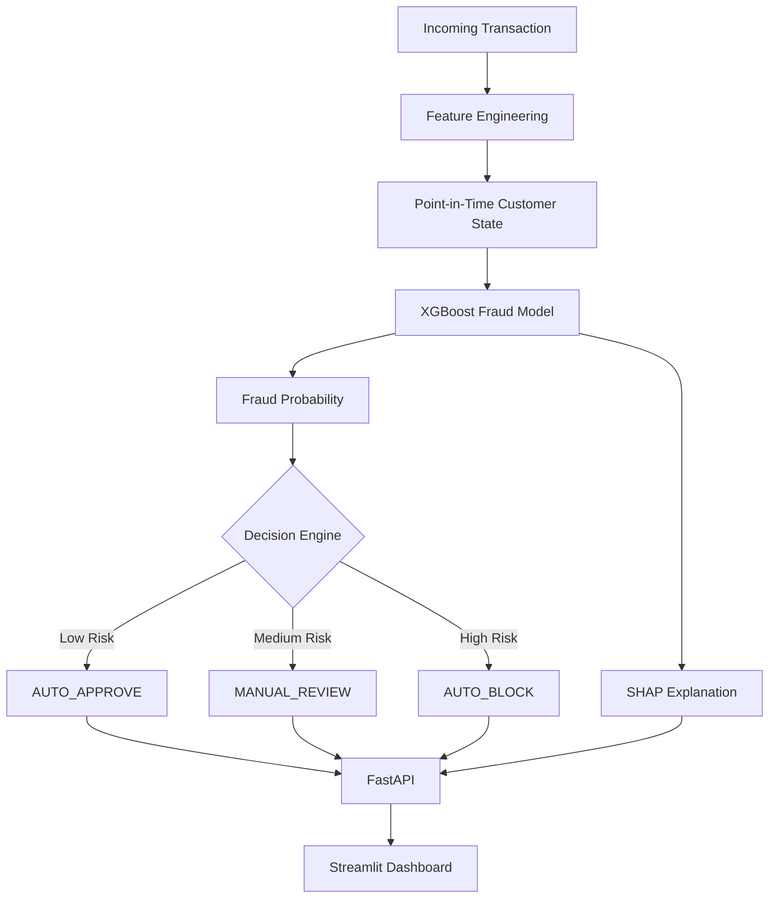

# Real-Time Fraud Detection System
### An Explainable, Pre-Authorization Fraud Detection Engine

A machine learning-based fraud detection system designed to identify suspicious mobile-money transactions **before authorization**. It combines point-in-time feature engineering, an XGBoost classification model, SHAP-based explanations, and a three-tier decision engine to support automated fraud prevention.

The project includes a FastAPI backend, an interactive Streamlit dashboard, and Docker-based deployment.

---

## 1. Project Overview

Financial fraud detection systems must identify suspicious transactions quickly without unnecessarily blocking legitimate customers.

This project addresses that challenge by building a real-time fraud detection pipeline that:

- Analyzes transaction information available before authorization.
- Predicts the probability that a transaction is fraudulent.
- Routes transactions into automated approval, manual review, or automatic blocking.
- Explains model predictions using SHAP.
- Provides an interactive dashboard for transaction monitoring and investigation.

**Dataset:** PaySim mobile-money transaction dataset (synthetic).

**Model:** XGBoost (champion model).

**Backend:** FastAPI
**Frontend:** Streamlit
**Explainability:** SHAP
**Deployment:** Docker and Docker Compose

---

## 2. Key Features

### Fraud Prediction
- Machine learning-based transaction risk scoring.
- Handles highly imbalanced fraud data.
- Uses a threshold-based decision policy.

### Three-Tier Decision Engine

| Decision | Meaning |
|---|---|
| AUTO_APPROVE | Low-risk transaction is approved automatically |
| MANUAL_REVIEW | Uncertain transaction is sent for further investigation |
| AUTO_BLOCK | High-risk transaction is blocked automatically |

### Explainable AI
- SHAP-based feature contribution analysis.
- Helps identify the factors influencing a fraud prediction.
- Supports transaction-level investigation.

### Point-in-Time Feature Engineering
- Uses transaction information available at decision time.
- Includes historical recipient-account activity.
- Avoids using post-transaction information during prediction.

### Interactive Dashboard
- Live transaction feed.
- Operations and fraud triage.
- SHAP transaction inspector.
- Manual transaction testing sandbox.

### API and Containerization
- FastAPI prediction and health endpoints.
- Docker-based application packaging.
- Docker Compose for running the API and dashboard together.

---

## 3. System Architecture



### Workflow

1. A transaction enters the system.
2. The feature engineering module generates prediction-time features.
3. Historical recipient-account information is retrieved from the customer state cache.
4. The XGBoost model calculates fraud probability.
5. The decision engine assigns a risk-based action.
6. SHAP generates explanations for the prediction.
7. FastAPI returns the prediction and related information.
8. The Streamlit dashboard displays the results.

---

## 4. Project Structure

```text
fraud-detection-system/
│
├── dashboard/
│   ├── app.py
│   ├── components.py
│   └── __init__.py
│
├── data/
│   ├── raw/
│   └── processed/
│
├── models/
│   ├── model.pkl
│   ├── dest_state.joblib
│   ├── eval_metrics.json
│   └── feature_meta.json
│
├── notebooks/
│   ├── 01_exploratory_data_analysis.ipynb
│   ├── 02_feature_engineering_experiments.ipynb
│   └── 03_model_prototyping_and_eval.ipynb
│
├── src/
│   ├── api.py
│   ├── config.py
│   ├── data_loader.py
│   ├── explain.py
│   ├── features.py
│   ├── simulator.py
│   └── train.py
│
├── tests/
│   ├── test_api.py
│   ├── test_data_leakage.py
│   ├── test_explain.py
│   ├── test_features.py
│   └── test_model.py
│
├── Dockerfile
├── docker-compose.yml
├── requirements.txt
├── render.yaml
└── README.md
```

### Main Components

| Component | Responsibility |
|---|---|
| `src/api.py` | FastAPI application and prediction endpoints |
| `src/features.py` | Feature engineering and customer state handling |
| `src/explain.py` | SHAP-based model explanations |
| `src/train.py` | Model training and evaluation |
| `src/data_loader.py` | Dataset loading |
| `src/simulator.py` | Transaction simulation |
| `dashboard/app.py` | Main Streamlit dashboard |
| `dashboard/components.py` | Dashboard visualization components |
| `models/` | Trained model and supporting artifacts |
| `tests/` | Automated tests |

---

## 5. Data Exploration and Preprocessing

The first notebook, `01_exploratory_data_analysis.ipynb`, explores the dataset and establishes a leak-free evaluation strategy.

Topics covered:

- Class imbalance and dataset scale.
- Fraud distribution across transaction types.
- Limitations of the legacy `isFlaggedFraud` rule.
- Chronological splitting of transaction data.

### Chronological Data Split

Instead of randomly splitting transactions, the project uses chronological boundaries:

| Dataset | Transaction steps | Number of rows |
|---|---:|---:|
| Training | 1–550 | 6,166,019 |
| Validation | 551–650 | 115,770 |
| Testing | 651–743 | 80,831 |

This simulates a more realistic situation in which a model learns from past transactions and is evaluated on future transactions.

---

## 6. Feature Engineering

The second notebook, `02_feature_engineering_experiments.ipynb`, focuses on point-in-time feature engineering and online-offline consistency.

### Important Feature Engineering Concepts

**Balance discrepancy**

Uses transaction amount and account balance information to identify unusual balance changes.

**Stateful point-in-time aggregations**

Maintains historical recipient-account information using transactions available before the current prediction.

**Online-offline parity**

Aims to ensure that features generated during model development are consistent with those generated when the API processes live transactions.

### Feature Categories

- Transaction amount.
- Origin and destination balances.
- Transaction time.
- Transaction type.
- Origin drain ratio.
- Destination account history.
- Merchant destination indicators.

The serving pipeline uses 15 model features.

### Preventing Data Leakage

Post-transaction information can make a fraud model appear more accurate than it would be in a real pre-authorization environment.

The project audits and removes seven post-settlement features, including destination and origin balance information that would not be available at the required prediction time.

A depth-2 tree experiment using leakage-prone features achieved a PR-AUC of 0.9684, illustrating why leakage checks are important.

---

## 7. Model Development and Evaluation

The third notebook, `03_model_prototyping_and_eval.ipynb`, compares classification models on an out-of-time test set.

### Models Compared

- Logistic Regression
- LightGBM
- XGBoost

### Champion Model: XGBoost

XGBoost was selected as the champion model based on its evaluation performance.

### Test Set Performance

| Metric | XGBoost |
|---|---:|
| PR-AUC | 0.9940 |
| ROC-AUC | 0.9999 |
| Precision | 99.64% |
| Recall | 81.31% |
| F1-score | 89.55% |
| Decision threshold | 0.9571 |

### Model Comparison

| Model | PR-AUC | ROC-AUC | Precision | Recall | F1-score |
|---|---:|---:|---:|---:|---:|
| Logistic Regression | 0.5855 | 0.9825 | 13.45% | 93.84% | 23.53% |
| LightGBM | 0.7160 | 0.8220 | 88.13% | 80.63% | 84.21% |
| XGBoost | **0.9940** | **0.9999** | **99.64%** | 81.31% | **89.55%** |

### Why PR-AUC?

Fraud datasets are highly imbalanced. Precision-recall evaluation helps assess how effectively a model identifies the minority fraud class without relying only on overall accuracy.

---

## 8. Confusion Matrix

The XGBoost test-set confusion matrix at threshold 0.9571:

| | Predicted Legitimate | Predicted Fraud |
|---|---:|---:|
| Actual Legitimate | 79,806 | 3 |
| Actual Fraud | 191 | 831 |

This represents:

- True Negatives: 79,806
- False Positives: 3
- False Negatives: 191
- True Positives: 831

The model identifies most fraudulent transactions while producing very few false positives at this threshold.

---

## 9. Decision Threshold Policy

The system uses a three-tier threshold policy:

| Threshold | Decision |
|---|---|
| Probability below 0.3829 | AUTO_APPROVE |
| Probability from 0.3829 to below 0.9571 | MANUAL_REVIEW |
| Probability at or above 0.9571 | AUTO_BLOCK |

The threshold policy is based on validation-set tuning.

At the selected validation threshold, the recorded results were:

- Precision: 99.35%
- Recall: 82.06%
- F1-score: 89.88%

The test-set metrics and validation-set threshold-tuning metrics are reported separately.

---

## 10. Explainable AI Using SHAP

The system integrates SHAP to explain individual fraud predictions.

Rather than returning only a fraud probability, the application can display which features contributed to a transaction's risk score.

### Important Features

The saved XGBoost feature importance results identify these leading features:

| Feature | Importance |
|---|---:|
| `orig_drain_ratio` | 40.70% |
| `is_merchant_dest` | 15.74% |
| `type_TRANSFER` | 14.58% |
| `hour_of_day` | 10.48% |
| `amount` | 7.67% |

These values represent model feature importance, not causal effects.

---

## 11. API

The backend is implemented using FastAPI.

### Main Endpoints

| Endpoint | Purpose |
|---|---|
| `/health` | Checks API health |
| `/predict` | Generates a fraud prediction |

Interactive API documentation is available through FastAPI's Swagger interface at `/docs`.

Example local address:

```text
http://localhost:8000/docs
```

---

## 12. Interactive Dashboard

The Streamlit dashboard provides a visual interface for monitoring and investigating transactions.

### Dashboard Modules

**Live Transaction Feed**

Displays incoming simulated transactions and their prediction results.

**Operations Triage**

Helps inspect transaction risk and decision categories.

**SHAP Transaction Inspector**

Displays feature contributions behind individual predictions.

**Manual Testing Sandbox**

Allows users to submit transaction details and observe the model's response.

---

## 13. Docker Setup

The application uses Docker to package its dependencies and runtime environment.

### Run Locally

Clone the repository:

```bash
git clone <YOUR_GITHUB_REPOSITORY_URL>
cd fraud-detection-system
```

Build and start the containers:

```bash
docker compose up --build
```

### Access the Application

| Service | Local URL |
|---|---|
| Streamlit Dashboard | http://localhost:8501 |
| FastAPI | http://localhost:8000 |
| API Documentation | http://localhost:8000/docs |
| API Health | http://localhost:8000/health |

To stop the containers:

```bash
docker compose down
```

---

## 14. Testing

The project includes automated tests for the main system components.

Run the tests:

```bash
python3 -m pytest tests/ -v
```

### Verified Test Results

**19 tests passed out of 19.**

| Test Module | Tests Passed |
|---|---:|
| API | 5 |
| Data Leakage | 2 |
| Explainability | 3 |
| Feature Engineering | 5 |
| Model | 4 |
| **Total** | **19** |

The test suite covers API behavior, data leakage checks, explainability, feature engineering, and model functionality.

---

## 15. Technology Stack

| Category | Technologies |
|---|---|
| Programming Language | Python |
| Data Processing | Pandas, NumPy, PyArrow |
| Machine Learning | XGBoost, LightGBM, Scikit-learn |
| Explainable AI | SHAP |
| Backend | FastAPI, Uvicorn |
| Frontend | Streamlit, Plotly |
| Serialization | Joblib, Pickle |
| Testing | Pytest |
| Containerization | Docker, Docker Compose |
| Deployment Configuration | Render Blueprint |

---

## 16. Dataset and Model Artifacts

The project uses the PaySim synthetic mobile-money transaction dataset.

Large raw and processed datasets are excluded from the Git repository to avoid unnecessary repository size.

The serving application requires its trained model and supporting state artifacts.

Important artifacts:

- `models/model.pkl` — trained model used by the prediction service.
- `models/dest_state.joblib` — historical recipient-account state cache.
- `models/eval_metrics.json` — model evaluation results.
- `models/feature_meta.json` — feature metadata.

The repository uses Git LFS tracking for the large recipient-state artifact.

---

## 17. Limitations

- PaySim is a synthetic dataset and does not represent every pattern found in real financial transactions.
- Fraud detection behavior may differ across financial institutions and transaction environments.
- The system's performance depends on the availability and correctness of prediction-time features.
- The reported evaluation metrics are based on the project's out-of-time test set and should not be interpreted as guaranteed real-world performance.
- The application is a prototype and requires additional validation, security controls, monitoring, and operational testing before production financial use.

---

## 18. Future Improvements

- Evaluate the model on additional real-world or independently generated transaction datasets.
- Improve model monitoring and fraud-pattern drift detection.
- Add authentication and role-based access control.
- Introduce persistent transaction storage and audit logs.
- Optimize model serving for production-scale workloads.
- Integrate additional real-time fraud signals.
- Expand deployment and cloud monitoring.

---

## 19. Project Summary

This project demonstrates an end-to-end fraud detection workflow, from data exploration and point-in-time feature engineering to model evaluation, explainability, API development, dashboard visualization, and Docker-based execution.

Its central focus is not only detecting fraud, but doing so using information available before transaction authorization while making model decisions interpretable and operationally useful.

**Built with Python, XGBoost, FastAPI, Streamlit, SHAP, and Docker.**
